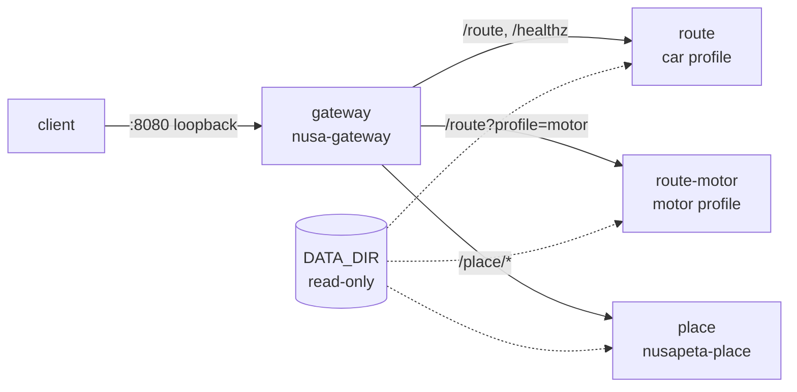

# Architecture



The stack owns integration only. Routing, graph format, index format, and the
HTTP contract live in the engine repositories:

- [nusapeta/route](https://github.com/nusapeta/route)
- [nusapeta/place](https://github.com/nusapeta/place)

## Processes

One graph file contains both vehicle classes, but the profile is fixed per
server process. The stack therefore runs the same image twice:

| Service | Command difference | Purpose |
|---|---|---|
| `route` | `-profile car` | default upstream |
| `route-motor` | `-profile motor` | `?profile=motor` |
| `gateway` | `nusa-gateway` entrypoint | single public surface |
| `place` | `nusa-place` entrypoint | geocoding, mounted at `/place` |

The gateway answers `/route` and `/healthz`, proxies `?profile=motor` to the
motor process, and mounts the geocoder at `/place`. `/metrics` is answered with
404; operators read it from the route containers directly.

## Ports and volumes

| Port | Bound by | Exposure |
|---|---|---|
| `127.0.0.1:8080` | gateway | the only published port |
| `8090` | place | Compose network only |
| `8080` | route, route-motor | Compose network only |

`DATA_DIR` is mounted read-only at `/data`. The gateway has no volume: it only
proxies. `read_only: true`, `cap_drop: [ALL]`, and `no-new-privileges` apply to
all services.

## Memory budget

| Service | Limit | Basis |
|---|---:|---|
| `route` | 1536m | measured 225 MiB RSS for four parallel 96 km routes; file pages are reclaimable |
| `route-motor` | 1536m | same graph, second process |
| `place` | 256m | 142 MB mapped index, anonymous RSS under 20 MB idle |
| `gateway` | 64m | proxy only |

Total ceiling is about 3.4 GB. A host with the Java extract instead of the
national graph uses the same limits; the graph is smaller.

## Data lifecycle

`scripts/bootstrap.sh` downloads release assets, verifies the published
`.sha256`, decompresses the graph, and leaves:

```
DATA_DIR/
  java.graph or indonesia.graph
  places-2026.11.idx
  places-2026.11.idx.json
  LICENSE-DATA
```

The index is immutable for the life of the process. A new data release means
restarting the place container with the new index and manifest.

## Failure behaviour

- `place` down: `/place/*` returns 502, `/healthz` and `/route` keep working.
- `route-motor` down: motor requests fail; car requests still work.
- Checksum mismatch: place refuses to start.
- Gateway down: no public surface; the route processes remain private.

## What this repository does not do

- It does not build graphs or indexes; use the engine release artifacts or
  build them from a PBF with the engine tooling.
- It does not include authentication, TLS, or a public tunnel by default.
  `compose.tunnel.yml` is an optional Cloudflare Tunnel overlay.
