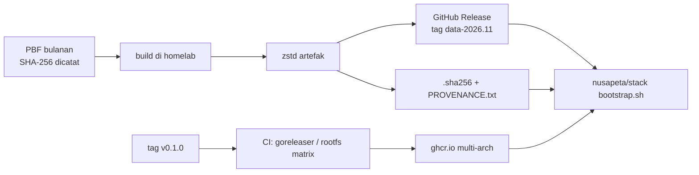

# Rencana Open Source: Nusapeta Route + Nusapeta Place

| Field | Value |
|---|---|
| Status | Eksekusi berjalan; tertahan di pembuatan org `nusapeta` |
| Tanggal | 2026-11-15 |
| Cakupan | `nusapeta/route` (Go, MIT), `nusapeta/place` (Rust, MIT), satu repo payung `nusapeta/stack` |
| Target | `v0.1.0` publik untuk ketiganya |
| Pemilik | arifsans |

Dokumen ini tinggal di repo payung (`nusapeta/stack/docs/`), bukan di repo engine.
Engine repo hanya menerima hasil akhirnya (checklist, workflow, README).

---

## Status eksekusi

Diperbarui 2026-11-15 12:50 UTC.

| Fase | Status | Bukti |
|---|---|---|
| 0 Higiene | selesai | route `5705e4d`, `b289cea`, `962adc4`, `baf3a9a`, `8e9ea46`; place `087ca0f`, `225b2f7`, `e13eb60`, `32add6e`, `e4f30ae` |
| 1 Artefak | selesai lokal | `~/Projects/artifacts/{route,place}-data-2026.11`; `sha256sum -c` dan `zstd -t` lolos |
| 2 Stack | selesai | `nusapeta/stack`; e2e 9/9 pada fixture Jakarta, artefak Java asli, dan data rilis nasional; CI `43715547736` hijau (`3304ac4`, 1 m 38 s dengan cache; sebelumnya `43712394705`, `43707544284`, `43711103633`) |
| 3 Dokumen publik | selesai kode | README EN + `docs/en/{QUICKSTART,API,ARCHITECTURE}.md` di kedua repo; CI route hijau |
| 4 Peluncuran | selesai | org `nusapeta` ada; route + place publik; stack dibuat dan CI-nya hijau; tag `v0.1.0` + `data-2026.11` terunggah dan diunduh anonim (route 5/5 + 8/8, place 3/3 + 8/8); image ghcr `route` + `place` publik dan tarik anonim berhasil |

Status GHCR (2026-11-15 13:23 UTC): `route` dan `place` sudah publik. Bukti
anonim: token pull 52 karakter, manifest `0.1.0` dan `latest` HTTP `200` untuk
keduanya, `docker pull` tanpa kredensial berhasil (route 36,8 MB, place
147,5 MB, keduanya `User=65532:65532`), lalu `docker compose pull` +
`docker compose up -d --wait` dari image publik menjalankan
`scripts/e2e.sh` 9/9 hijau pada 13:24 UTC. `route-tools` sengaja tetap
privat: image itu hanya dipakai job CI `tools-image`, tidak dirujuk
`compose.yml`.

Catatan proses: GitHub tidak menyediakan endpoint REST untuk mengubah
visibilitas paket container milik organisasi. `GET
/orgs/nusapeta/packages/container/route` mengembalikan 200 (tertaut ke
`nusapeta/route`, tag `0.1.0` + `latest`), tetapi `PATCH` dengan body
`visibility=public` mengembalikan `404` meski token memegang
`write:packages` dan pengguna `admin` org; GraphQL hanya punya
`deletePackageVersion` (Stack Overflow 77092191,
OpenCTI-Platform/connectors#5985). Perubahan visibilitas selalu lewat UI:
`https://github.com/orgs/nusapeta/packages/container/package/<paket>/settings`
→ Danger Zone → Change visibility.

---

## 1. Positioning

Satu kalimat yang harus muncul di ketiga README, sama kata-katanya:

> **Stack geo Indonesia yang self-hosted: routing + geocoding, satu file per
> engine, idle sekitar 48 MB, rebuild dalam menit, tanpa database.**

Angka pendukung (sudah terukur, jangan diubah tanpa pengukuran baru):

| Metrik | Nilai | Sumber |
|---|---:|---|
| Idle RSS nusapeta/route (graph nasional) | 17,8 MB | ukur 2026-11-15, image 0.1.0, compose (`-conc 2 -workspace-mb 384`) |
| Idle RSS nusapeta/place | 6,15 MiB | `nusapeta/place/docs/research/NFR-REVIEW.md` NFR-004 |
| Total idle stack | **48.480 kB RSS / 41.369 kB PSS** | ukur 2026-11-15, `stack/compose.yml`, empat proses |
| Artefak nusapeta/route nasional | 1.621 MB | `/healthz` produksi |
| Artefak nusapeta/place | 141.997.032 B | NFR-003 |
| Build nusapeta/route nasional | 1m12s ekstraksi | ROADMAP budget |
| Build nusapeta/place | 228,42 s | NFR-006 |

Non-goals publik (sudah ada di kedua repo, pertahankan kata-katanya):

- Bukan engine latency tercepat. OSRM 26× lebih cepat di p50.
- Bukan Nominatim parity. Alamat rumah tidak didukung (hanya 107.088 objek punya
  `addr:housenumber` dari 328 juta objek).
- Tanpa traffic real-time, tanpa cakupan dunia, tanpa CH/MLD penuh.
- Bukan layanan multi-tenant dengan SLA.

Alasan: proyek yang menyatakan batasnya sendiri lebih mudah dipercaya, dan
menutup pintu scope creep sebelum ada yang memintanya.

---

## 2. Keputusan yang harus dikunci sebelum menyentuh kode

| #   | Keputusan      | Pilihan                                                                                                                                                                              | Alasan                                                                                 | Biaya                                   |
| --- | -------------- | ------------------------------------------------------------------------------------------------------------------------------------------------------------------------------------ | -------------------------------------------------------------------------------------- | --------------------------------------- |
| D1  | Topologi repo  | 2 repo engine + 1 repo `nusapeta/stack`                                                                                                                                              | Bahasa berbeda (Go/Rust), rilis berbeda; integrasi tetap teruji publik                 | 1 repo tambahan                         |
| D2  | Nama           | **Ganti ke Nusapeta**: org `nusapeta`, repo `route`/`place`/`stack`, binary `nusa-*`, crate `nusa-place`. Ketersediaan diuji 2026-11-15: org bebas, crates bebas, 0 repo bertabrakan | `placeid` bertabrakan dengan Google Place ID; nama payung dibutuhkan untuk tiga repo   | sed sudah dijalankan; org dibuat manual |
| D3  | Bahasa dokumen | EN untuk `README`, `QUICKSTART`, `API`, `ARCHITECTURE`; ID untuk `PRD/SRS/TRD/ROADMAP/BACKLOG/paper/OPERATIONS`                                                                      | 48k kata tidak akan diterjemahkan ulang; kontributor butuh EN di jalur masuk           | ±6 dokumen                              |
| D4  | Lisensi        | Kode MIT (sudah); data/artefak **ODbL 1.0** eksplisit                                                                                                                                | `.graph` dan `.idx` adalah turunan database OSM                                        | 2 file lisensi                          |
| D5  | Model dukungan | Research preview, tanpa SLA, data refresh bulanan best-effort                                                                                                                        | Satu maintainer                                                                        | —                                       |
| D6  | Versioning     | Kode: SemVer tag `v0.1.0`. Data: tag `data-2026.11` terpisah                                                                                                                         | Data dan kode punya siklus hidup berbeda                                               | 1 workflow                              |
| D7  | Kontribusi     | DCO (`Signed-off-by`), tanpa CLA                                                                                                                                                     | CLA menghalangi kontributor                                                            | 1 file                                  |
| D8  | Kompatibilitas | Format `.graph` v5 dan `.idx` v1 = kontrak publik; versi di header                                                                                                                   | Format sudah versioned; jangan janjikan stabilitas API HTTP di 0.x                     | —                                       |
| D9  | Domain demo    | Satu situs `route.arifsani.xyz`: rute di `/route`, pencarian di `/place/*` (reverse proxy ke nusapeta/place); tidak ada `place.arifsani.xyz` terpisah | Satu domain = satu TLS + satu tunnel; pencarian sudah tampil di UI yang sama | 0                                       |

D2 **sudah dieksekusi** 2026-11-15, sebelum ada rilis, tag, atau image:
module `github.com/nusapeta/route`, crate `nusa-place`, binary `nusa-*`,
compose service `nusapeta-*`, metrik `nusa_route_*`/`nusa_place_*`, env
`NUSAPETA_ROUTE_*`/`NUSA_PLACE_*`. Yang sengaja **tidak** diubah: magic format
`RIDG` dan `PLACEID\0` (identifier on-disk, bukan merek), serta berkas bukti
(`paper/`, `docs/research/`, `anti-slop/`, `docs/M6.md`, `docs/PLAN-*`) yang
merekam angka dan perintah pada commit lama.

Sisa langkah manual: buat organisasi `nusapeta` di GitHub, lalu transfer
`route`/`place` ke sana. Tidak ada API untuk membuat organisasi, jadi ini satu-
satunya langkah yang tidak bisa diotomasi.

---

## 3. Skor kesiapan

Status per 2026-11-15 12:45 UTC; CI mengacu ke commit terakhir di `main`.

| Item | nusapeta/route | nusapeta/place | Target |
|---|---|---|---|
| Kode terbaca, test ada | ✅ 104 test, golden | ✅ 47 test | pertahankan |
| CI build + test | ✅ 2/2 hijau, 48 s (`84e6b15`, run `43716220360`) | ✅ 3/3 hijau, 38 s (`4eab670`, run `43716238500`; `docs` + `rust` + `arm64`; run dingin `43711875214` 29 m dengan `arm64` 28 m 55 s) | hijau |
| Repo publik | ✅ publik 2026-11-15 | ✅ publik 2026-11-15 | publik |
| Deskripsi / topik / homepage | ✅ terisi | ✅ terisi | terisi |
| Tag / release | ✅ `v0.1.0` (5 aset) + `data-2026.11` (8 aset) | ✅ `v0.1.0` (3 aset) + `data-2026.11` (8 aset) | `v0.1.0` |
| Artefak siap pakai | ✅ 8/8 aset, `sha256sum -c` anonim lolos | ✅ 8/8 aset, `sha256sum -c` anonim lolos | 1 release data |
| Image publik (ghcr) | ✅ publik 13:23 UTC; anonim: token 52 char, manifest `0.1.0` + `latest` `200`, `docker pull` 36,8 MB, `User=65532:65532` | ✅ publik 13:23 UTC; anonim: token 52 char, manifest `0.1.0` + `latest` `200`, `docker pull` 147,5 MB, `User=65532:65532` | multi-arch |
| Infra pribadi di tree | ✅ disanitasi | ✅ disanitasi | disanitasi |
| `CONTRIBUTING`/`SECURITY` | ✅ EN `8e9ea46` | ✅ EN `e4f30ae` | keduanya |
| `CODE_OF_CONDUCT`, template issue | ✅ EN `8e9ea46` | ✅ EN `e4f30ae` | keduanya |
| `go install` berfungsi | ✅ diuji dari `proxy.golang.org` (`nusa-serve@v0.1.0`) | n/a | ✅ |
| Batas lisensi data | ✅ `LICENSE-DATA` | ✅ `LICENSE-DATA` | eksplisit |
| README Inggris | ✅ `README.md` + `docs/en/` | ✅ `README.md` + `docs/en/` | ✅ |

### 3.1 Audit GitHub awal (2026-11-15 pagi)

Snapshot ini menjelaskan kondisi sebelum Fase 0 dan tidak lagi menjadi status
terkini. Temuan yang sudah diperbaiki ditandai.

| Temuan | nusapeta/route | nusapeta/place | Dampak |
|---|---|---|---|
| Visibilitas | privat | privat | rilis = flip visibility + atur setelan yang baru tersedia |
| Deskripsi, homepage, topics | kosong | kosong | repositori tidak muncul di pencarian/topik sebelum org ada |
| License terdeteksi | MIT | MIT | aman, badge akan muncul saat publik |
| Release / tag | 0 | 0 | belum ada jalur unduh |
| CI terakhir | ✅ 2/2 hijau (`a5b4367`) | ✅ `docs` + `rust` hijau (`273b296`); `arm64` dipindah ke `push` saja | dicek ulang setelah org ada |
| Branch protection | ❌ 403 | ❌ 403 | "Upgrade to GitHub Pro or make this repository public" — terkunci oleh visibilitas |
| Dependabot alerts | ✅ aktif 2026-11-15 | ✅ aktif 2026-11-15 | aktifkan setelah transfer |
| `delete_branch_on_merge` | ✅ aktif | ✅ aktif | ada 2 branch mati dari PR merged |
| `has_projects` | ✅ mati | ✅ mati | tab kosong di repo publik |
| Discussions / wiki | mati | mati | keputusan sadar, biarkan |
| Default workflow permissions | `read` | `read` | ✅ aman |
| Local vs `origin/main` | ✅ sync (`baf3a9a`) | ✅ sync (`32add6e`) | — |
| Pages | tidak ada | tidak ada | opsi untuk docs site nanti |

**CI nusapeta/place.** Kegagalan lama berasal dari `rustsec/audit-check@v2`
yang mencoba membuat check run dengan `permissions: contents: read`. Audit
sendiri lolos: 0 vulnerability. Workflow sekarang memakai `cargo audit` dan
`cargo deny`; job `docs` juga menolak keyword RFC huruf kecil, data file besar,
dan fixture yang membengkak.

**Temuan dependency.** `cargo audit` melaporkan satu *unsound*:
`RUSTSEC-2026-0186` pada `memmap2 0.5.10`, ditarik oleh `osmpbf 0.3.8`
(versi terbaru di crates.io). Yang terpengaruh hanya `advise_range`,
`flush_range`, dan `flush_async_range`; `osmpbf` cuma memanggil
`memmap2::Mmap::map` (`mmap_blob.rs:40,64`), jadi jalur rentan tidak
terpakai. Ignore beserta justifikasinya ada di `.cargo/audit.toml`; cabut
setelah `osmpbf` merilis versi dengan `memmap2 >= 0.9.11`.


## 4. Fase 0 — Higiene repo (Hari 1–5)

Tujuan: repo layak dilihat orang luar. Tidak ada fitur baru di fase ini.

### 4.1 nusapeta/route

**R0.1 Module path — selesai.** `go.mod` sekarang
`module github.com/nusapeta/route`; semua file Go memakai prefiks itu; `ldflags`
di `Makefile` dan `Dockerfile` menunjuk
`github.com/nusapeta/route/internal/extract.Version`. `go mod tidy` sudah
dijalankan dan membuang `golang.org/x/sys v0.49.0` yang tidak dipakai, jadi
`tidy -diff` kini aman dijadikan job CI.

Verifikasi ulang:

```bash
go build ./... && go test ./... && gofmt -l .
```

`go install github.com/nusapeta/route/cmd/nusa-extract@latest` baru bisa diuji
dari internet setelah organisasi `nusapeta` dibuat dan repo publik.

**R0.2 Sanitasi infra pribadi.**

| File | Tindakan |
|---|---|
| `deploy/docker-compose.yml` | komentar homelab + `http://nusapeta-place:8090` tetap, tapi jadikan `-place` **opsional** (sudah default kosong) dan beri komentar "contoh, hapus bila tidak memakai nusapeta/place" |
| `deploy/docker-compose.homelab.yml` | pindah ke `deploy/examples/homelab/` |
| `docs/bruno/`, `docs/*.postman_environment*.json` | pindah ke `contrib/http/`, ganti host jadi `${BASE_URL}`; hapus `192.168.1.219` dan `route.arifsani.xyz` |
| `deploy/README.md` | hapus domain pribadi, ganti `${PUBLIC_HOST}` |
| `anti-slop/` | pindah ke `docs/claims/` + `README.md` yang menjelaskan ini ledger klaim; nama folder internal jangan tampil di repo publik |

Verifikasi: `rg -n 'arifsani|192\.168\.' --glob '!LICENSE' --glob '!*.md'` harus
kosong; hasil `rg` di `*.md` hanya boleh menyebut baris lisensi dan contoh yang
sudah di-placeholder.

**R0.3 Lisensi data.** Tambah `LICENSE-DATA`:

```text
Data artifacts (.graph, and any file derived from OpenStreetMap) are a
Derivative Database under ODbL 1.0.
© OpenStreetMap contributors. https://www.openstreetmap.org/copyright
Code in this repository is MIT; see LICENSE.
```

Sertakan file yang sama di dalam setiap release artefak, dan baris atribusi di
`/healthz` + halaman demo.

**R0.4 File komunitas (salin gaya nusapeta/place, sesuaikan).**

```
CONTRIBUTING.md          # setup, make test, aturan klaim angka, DCO
SECURITY.md             # cara lapor, ekspektasi respons 7 hari best-effort
CODE_OF_CONDUCT.md      # Contributor Covenant 2.1
CHANGELOG.md            # Keep a Changelog, mulai [0.1.0]
.github/ISSUE_TEMPLATE/bug.yml
.github/ISSUE_TEMPLATE/feature.yml
.github/ISSUE_TEMPLATE/data.yml     # laporan salah rute/data OSM
.github/ISSUE_TEMPLATE/config.yml
.github/PULL_REQUEST_TEMPLATE.md
.github/dependabot.yml  # gomod + github-actions + docker, mingguan
```

Aturan yang harus tertulis di `CONTRIBUTING.md`: setiap PR yang mengubah
perilaku rute wajib menyertakan pasangan from/to dan hasil `nusa-graphinfo`;
angka performa tanpa mesin + commit + perintah reproduksi ditolak.

**R0.5 CI tambahan.** Di `ci.yml`:

```yaml
- run: go mod tidy -diff          # go 1.27 punya flag ini
- run: go test -race ./...        # sudah ada
- uses: golang/govulncheck-action@v1
- name: docs links
  run: python3 scripts/check_links.py
```

`scripts/check_links.py` (baru, ±40 baris): ekstrak semua tautan relatif dari
`*.md`, pastikan file target ada. Ini menangkap kelas bug yang paling sering
muncul saat repo dirapikan (tautan pindah folder).

**R0.6 Image tools terpisah.** `Dockerfile` saat ini hanya memuat `nusa-serve`
dan `nusa-gateway`, jadi pengguna tidak bisa membangun graph dari container.
Jangan tambahkan `nusa-extract` ke image utama (hard limit image 40 MB).
Buat `Dockerfile.tools` yang menghasilkan
`ghcr.io/nusapeta/route-tools:<tag>` berisi `nusa-extract`, `nusa-graphinfo`,
`nusa-tagstats`, `nusa-snapcheck`.

**R0.8 Catatan nama pra-rename — selesai.** `paper/README.md` memuat tabel
padanan `rid-*` → `nusa-*`; `paper/RESULTS.md`, `paper/COMPARISON.md`, dan
`docs/M6.md` diberi banner satu baris yang menunjuk tabel itu. Angka, commit,
dan nama berkas hasil di dalamnya tidak diubah.

**R0.9 Migrasi deployment homelab.** Repo sudah memakai nama baru, host
belum. Tanpa langkah ini demo produksi berjalan dengan unit/container lama dan
dashboard metrik kehilangan seri:

| Objek | Tindakan |
|---|---|
| systemd | `install -m644 deploy/nusapeta-route.service /etc/systemd/system/`; `systemctl daemon-reload`; disable + hapus unit lama |
| compose | `docker compose -p nusapeta-route up -d`, lalu hapus container lama; path data tetap `/srv/nusapeta-route` (symlink dari path lama bila perlu) |
| Prometheus | ganti job name + label `nusapeta-route` / `nusapeta-place`; metrik kini `nusa_route_*` / `nusa_place_*` |
| Grafana | impor `ops/grafana-place.json` (UID baru), arsipkan dashboard lama |
| Tunnel | hostname publik tidak berubah (lihat D9); cukup arahkan service ke port yang sama |

Verifikasi: `/healthz` 200, `/metrics` memuat `nusa_route_*`, tidak ada unit
atau container bernama lama yang masih jalan.

**R0.7 Drift dokumentasi kode.** `cmd/nusa-restats` ada dan ikut ter-build, tapi
tidak muncul di daftar struktur repo README. Audit cepat: bandingkan
`ls cmd/` dengan daftar di `README.md` dan `docs/README.md`; setiap binary harus
punya satu baris penjelasan dan satu perintah contoh.

### 4.2 Setelan repo GitHub (berlaku untuk kedua repo)

Prasyarat: organisasi `nusapeta` sudah dibuat **manual di web** (tidak ada API
untuk membuat organisasi), lalu repo lama dipindahkan:

```bash
gh repo rename route --repo arifsans/routeid
gh repo rename place --repo arifsans/placeid
gh repo transfer arifsans/route nusapeta
gh repo transfer arifsans/place nusapeta
git -C route remote set-url origin git@github.com:nusapeta/route.git
git -C place remote set-url origin git@github.com:nusapeta/place.git
```

Setelah itu semua perintah di bawah memakai `nusapeta/route` dan
`nusapeta/place`. Audit `gh` (§3.1) menunjukkan setelan repo masih default;
jalankan setelah file komunitas masuk, sebelum flip visibility.

```bash
# metadata: tanpa ini repo tidak muncul di pencarian maupun topic
gh repo edit nusapeta/route \
  --description "Memory-mapped OSM router for Indonesia: one binary, one graph file, ~17 MB idle" \
  --homepage "https://route.arifsani.xyz" \
  --add-topic openstreetmap --add-topic routing --add-topic indonesia \
  --add-topic self-hosted --add-topic golang --add-topic low-memory --add-topic mmap

gh repo edit nusapeta/place \
  --description "Self-hosted OpenStreetMap geocoder for Indonesia: one index file, ~6 MB idle" \
  --homepage "https://route.arifsani.xyz/place/search?q=monas" \
  --add-topic openstreetmap --add-topic geocoding --add-topic indonesia \
  --add-topic self-hosted --add-topic rust --add-topic low-memory --add-topic reverse-geocoding

# higiene merge: sudah dijalankan 2026-11-15 pada arifsans/routeid + placeid;
# setelan ini ikut saat rename/transfer
for r in route place; do
  gh repo edit nusapeta/$r --enable-squash-merge --delete-branch-on-merge --enable-issues
  gh api -X PATCH repos/nusapeta/$r \
    -F allow_merge_commit=false -F allow_rebase_merge=false \
    -F has_wiki=false -F has_projects=false
done

# branch mati code/antislop-audit-002 dan docs/antislop-audit-001
# sudah dihapus 2026-11-15; tidak ada perintah tersisa.

# Dependabot alerts: sudah aktif di kedua repo 2026-11-15.
```

Setelah repo publik (urutan ada di §8.1), aktifkan hal yang terkunci oleh
visibilitas:

```bash
# secret scanning + push protection: hanya tersedia di repo publik (free plan)
gh repo edit nusapeta/route --enable-secret-scanning \
  --enable-secret-scanning-push-protection
gh repo edit nusapeta/place --enable-secret-scanning \
  --enable-secret-scanning-push-protection

# branch protection: sekarang 403 "Upgrade to GitHub Pro or make this repository public"
gh api -X PUT repos/nusapeta/route/branches/main/protection \
  --input - <<'JSON'
{"required_status_checks":{"strict":true,"contexts":["test"]},
 "enforce_admins":false,
 "required_pull_request_reviews":{"required_approving_review_count":0},
 "restrictions":null,
 "allow_force_pushes":false,
 "allow_deletions":false}
JSON
```

Untuk nusapeta/place, context status check wajib `docs` dan `rust`. Sesuaikan nama job
di `ci.yml` lebih dulu — branch protection mengunci nama job, jadi ganti nama
job sekarang kalau mau dirapikan, bukan setelah repo punya kontributor.

**Pemeriksaan riwayat sebelum publik.** Sudah dijalankan 2026-11-15: `git log -p
--all` di kedua repo tidak memuat token, private key, atau password. Token
Cloudflare hanya muncul sebagai placeholder `CLOUDFLARE_TUNNEL_TOKEN=...` di
dokumentasi, dan satu regex deteksi di `nusapeta/place/scripts/check_consistency.py`.
Tidak perlu rewrite history.

### 4.3 nusapeta/place

**P0.1 Hapus artefak ter-track.** Empat file `.pyc` masuk repo:

```bash
cd place
git rm -r --cached scripts/__pycache__
printf '\n# Python\n__pycache__/\n*.pyc\n' >> .gitignore
```

**P0.2 Publik.** README masih menyebut "Repo ... (private)". Ganti; hapus
bagian "GitHub CLI" dari jalur masuk (pindah ke `CONTRIBUTING.md`).

**P0.3 Metadata crate.** `Cargo.toml`:

```toml
homepage = "https://github.com/nusapeta/place"
readme = "README.md"
keywords = ["geocoding", "openstreetmap", "indonesia", "search", "reverse-geocoding"]
categories = ["science::geo"]
# format index belum stabil; jangan janjikan stabilitas crate
publish = false
```

**P0.4 Sanitasi infra.** `deploy/openresty/place.arifsani.xyz.conf` →
`deploy/examples/openresty/place.conf.example`, ganti `server_name`,
`access_log`, path sertifikat jadi placeholder. Pastikan `deploy/.env`
tidak pernah ter-track (sudah di `.gitignore`; verifikasi dengan
`git ls-files | grep env`).

Tambahan terukur: `deploy/README.md` menyuruh menyalin `.env`, tetapi repo
tidak punya `.env.example` — pengguna baru akan gagal di langkah pertama. Buat
`deploy/.env.example`:

```bash
COMPOSE_FILE=docker-compose.yml:docker-compose.homelab.yml
NUSA_PLACE_IMAGE=ghcr.io/nusapeta/place:0.1.0
```

**P0.5 CI: hijaukan yang sekarang merah.** Job `rust` gagal di step `Audit`
bukan karena advisory, tapi karena `rustsec/audit-check` tidak boleh membuat
check run dengan `permissions: contents: read`. Dua pilihan, pilih salah satu:

1. **Ganti action dengan CLI** (disarankan): hilangkan ketergantungan pada
   check-run API dan ~4 menit kompilasi `cargo-audit` per run.

   ```yaml
   - name: Install cargo-audit
     run: cargo install cargo-audit --locked
   - name: Audit
     run: cargo audit
   ```

   Kalau menit Actions privat jadi masalah sebelum repo dibuka, cache binary
   dengan `Swatinem/rust-cache` atau `taiki-e/install-action@cargo-audit`.

2. **Pertahankan action**, tambahkan izin minimum:

   ```yaml
   permissions:
     contents: read
     checks: write
   ```

**P0.5b Advisory `RUSTSEC-2026-0186`.** `osmpbf 0.3.8` adalah versi terbaru dan
masih menarik `memmap2 0.5.10`. Jalur rentan tidak dipakai (lihat §3.1), jadi:

- buka issue upstream `osmpbf` untuk menaikkan `memmap2` ke `>=0.9.11`;
- tambahkan `.cargo/audit.toml` dengan justifikasi, bukan tanpa catatan:

  ```toml
  [advisories]
  # osmpbf 0.3.8 hanya memakai Mmap::map; fungsi rentan (advise_range,
  # flush_range, flush_async_range) tidak dipanggil. Cabut ignore ini setelah
  # osmpbf merilis versi dengan memmap2 >= 0.9.11.
  ignore = ["RUSTSEC-2026-0186"]
  ```

- cantumkan di `CHANGELOG.md` 0.1.0 supaya pengguna tahu ini disengaja.

**P0.5c Turunkan durasi CI.** Run nusapeta/place 5–9 menit, hampir seluruhnya kompilasi
tool audit. Setelah dua langkah di atas, target wajar <60 detik untuk job
`rust` (cache cargo + fixture kecil sudah ada).

**P0.5d Job tambahan.** (a) `arm64` QEMU yang **hanya build + smoke**, dengan
komentar bahwa NFR-007 diukur di QEMU sehingga performa tidak diklaim;
(b) `cargo deny check licenses` karena `docs/DEPENDENCIES.md` sudah menjanjikan
audit lisensi tapi CI belum menegakkannya.

Catatan hasil: build Rust `--release` di bawah QEMU awalnya lewat 50 menit
tanpa cache; setelah cache layer `type=gha` aktif, run pertama yang hijau
(`43711875214`) selesai dalam 28 m 55 s. Job `arm64` dibatasi ke `push` di
`main` (`if: github.event_name != 'pull_request'`). Workflow `release` tetap
membangun `linux/arm64`, jadi regresi arm64 tertangkap sebelum tag tanpa
membebani tiap PR.

**P0.6 File komunitas.** `CODE_OF_CONDUCT.md`, issue template, PR template,
`CHANGELOG.md` (0.1.0), `dependabot.yml` (`cargo` + actions + docker).

### 4.4 Definition of done Fase 0

- [x] `go install` nusapeta/route berhasil dari direktori kosong — 2026-11-15
      12:52 UTC, `GOBIN=/tmp/goinst/bin go install
      github.com/nusapeta/route/cmd/nusa-serve@v0.1.0` tanpa token, hasil
      10.496.958 B
- [x] `rg 'arifsani|192\.168\.'` bersih di file non-lisensi (`baf3a9a`)
- [x] `nusapeta/place` tidak lagi punya file `.pyc` ter-track
- [x] `LICENSE-DATA` ada di kedua repo
- [x] CI nusapeta/place hijau, plus job baru di kedua repo — route 2/2 hijau 53 s (`a5b4367`); place `docs` + `rust` hijau, `arm64` dipindah ke `push` saja karena ~50 menit di QEMU (`273b296`)
- [x] `.cargo/audit.toml` memuat ignore `RUSTSEC-2026-0186` + justifikasi
- [x] Deskripsi, homepage, topics terisi di kedua repo — route: 7 topik,
      `https://route.arifsani.xyz`; place: 8 topik,
      `https://route.arifsani.xyz/place/search?q=monas` (dicek 2026-11-15)
- [x] Squash-only, delete-branch-on-merge, projects mati — `2026-11-15`
- [x] Dependabot alerts aktif di kedua repo — `2026-11-15`
- [x] Branch `code/antislop-audit-002` dan `docs/antislop-audit-001` dihapus — `2026-11-15`
- [x] Semua tautan relatif di `docs/` valid
- [x] Berkas bukti beku menunjuk padanan nama lama → baru (`paper/README.md`)
- [ ] Demo produksi jalan dengan nama baru; metrik `nusa_*` ter-scrape —
      route `/healthz` 200, `/version` (`e1c4b0e`, 2026-11-12), place
      `/place/search?q=monas` 200 (dicek 2026-11-15 12:53 UTC); `/metrics`
      sengaja diblokir gateway (`--block-metrics`, 404) dan stack demo tidak
      menjalankan Prometheus, jadi butir scrape tetap terbuka
- [x] `CODE_OF_CONDUCT.md`, issue/PR template, `CHANGELOG.md` ada di kedua repo
- [x] Riwayat git bersih dari secret (diverifikasi 2026-11-15)

---

## 5. Fase 1 — Artefak dan rilis (Hari 6–12)

Tanpa ini, satu-satunya cara mencoba stack adalah mengunduh PBF 1,7 GB dan
punya 8 GiB RAM. Itu blocker konversi terbesar.



### 5.1 Isi release data

Tag `data-2026.11` di masing-masing repo (bukan `v*`, supaya tidak bertabrakan
dengan release kode).

| Aset | Repo | Ukuran | Catatan |
|---|---|---:|---|
| `indonesia-v5-2026.11.graph.zst` | nusapeta/route | **552.034.184 B** (526,5 MiB) | `zstd -19 -T4`; rasio 34,05%; 1.621.222.584 B setelah dekompresi |
| `java-v5-2026.11.graph.zst` | nusapeta/route | **228.058.747 B** (217,5 MiB) | rasio 32,89%; 693.316.412 B setelah dekompresi |
| `places-2026.11.idx` | nusapeta/place | **141.997.032 B** (135,4 MiB) | sha256 file `a732b4ec…836d`; manifest memakai digest isi `0df44207…2bca` |
| `places-2026.11.idx.json` | nusapeta/place | 1.428 B | manifest, sha256 `aeaec0a7…d23a` |
| `*.sha256` | keduanya | kecil | satu file per aset |
| `PROVENANCE.txt` | keduanya | kecil | PBF SHA-256, URL sumber, commit extractor, perintah build, mesin, tanggal |
| `LICENSE-DATA` | keduanya | kecil | ODbL |

Perkiraan 0,9–1,1 GB untuk graph nasional **tidak berlaku**: hasil terukur
552 MB. Batas aset GitHub 2 GiB tetap aman. Artefak dibangun di homelab
(`zstd -19 -T4`, 4 core); CI hanya merilis kode.

Aturan: **artefak dibangun di homelab, bukan di CI.** Runner GitHub 16 GB RAM
cukup secara teori, tapi PBF 1,7 GB + `target/` + artefak melewati disk 14 GB
dan membuat rilis tidak deterministik. Tiap repo punya `scripts/publish_data.sh`
sendiri (`nusapeta/route`, `nusapeta/place`) karena nama aset dan pemeriksaan
integritasnya berbeda: skrip place memverifikasi digest isi index terhadap
`index.sha256` di manifest sebelum mengunggah. Keduanya memakai
`gh release upload --clobber`, menolak tag yang tidak berawalan `data-`, dan
menolak publikasi bila `PROVENANCE.txt` atau `LICENSE-DATA` tidak ada di
direktori artefak. Keduanya sudah diuji pada tag sekali pakai.

### 5.2 Rilis kode

**nusapeta/route** — `.goreleaser.yaml` (isinya sudah sesuai file di repo):

```yaml
version: 2
project_name: nusapeta-route
before:
  hooks: [go mod tidy]
builds:            # lima binary, semuanya linux+darwin × amd64+arm64
  - {id: nusa-serve,    main: ./cmd/nusa-serve}
  - {id: nusa-gateway,  main: ./cmd/nusa-gateway}
  - {id: nusa-extract,  main: ./cmd/nusa-extract}
  - {id: nusa-route,    main: ./cmd/nusa-route}
  - {id: nusa-graphinfo, main: ./cmd/nusa-graphinfo}
archives:
  - formats: [tar.gz]
    name_template: "{{ .ProjectName }}_{{ .Version }}_{{ .Os }}_{{ .Arch }}"
checksum:
  name_template: SHA256SUMS
```

Verifikasi 2026-11-15: `go run github.com/goreleaser/goreleaser/v2@v2.12.7 check`
lolos; snapshot release selesai 36 s, empat arsip berisi `CHANGELOG.md`,
`LICENSE`, `LICENSE-DATA`, `README.md`, `README.id.md`, dan lima binary;
`dist/SHA256SUMS` memuat empat baris.

**nusapeta/place** — workflow `release.yml`: matrix `linux/amd64`
(`x86_64-unknown-linux-gnu`) + `linux/arm64` (`aarch64-unknown-linux-gnu`);
tiap sel memakai `docker/build-push-action@v7` dengan
`outputs: type=local,dest=$RUNNER_TEMP/rootfs` sehingga binary rilis identik
dengan isi image (QEMU hanya untuk build arm64), lalu memaketkan `nusa-place` +
`nusa-place-build` + `README.md` + `LICENSE` + `LICENSE-DATA` menjadi
`nusapeta-place_<versi>_<target>.tar.gz`. Job `release` mengunduh kedua artefak,
menulis `SHA256SUMS`, dan memakai `softprops/action-gh-release@v3`. Job `image`
terpisah membangun `ghcr.io/nusapeta/place` multi-arch. Cache `type=gha` dengan
scope per target.

Verifikasi 2026-11-15: `docker build --output type=local,dest=/tmp/place-rootfs .`
menghasilkan `/tmp/place-rootfs/usr/local/bin/{nusa-place,nusa-place-build}`,
keduanya melaporkan `0.1.0`; `--verify-checksum` ada di `--help`. Workflow
`release` untuk tag `v0.1.0` (run `43711885137`) selesai dengan body dari
`docs/releases/v0.1.0.en.md` dan tiga aset; pengunduhan anonim plus
`sha256sum -c` lolos.

Catatan terukur: `GOOS=darwin GOARCH=arm64 go build -o /tmp/nusa-bin/ ./cmd/...`
sudah diuji dan berhasil (mmap memakai `syscall.Mmap` yang ada di Linux dan
Darwin). Jadi `goos: [linux, darwin]` aman; jangan tambahkan `windows` — tidak
ada `syscall.Mmap`.

**Image**: `ghcr.io/nusapeta/route:0.1.0` (linux/amd64, linux/arm64) dan
`ghcr.io/nusapeta/place:0.1.0`, plus tag `-tools` untuk nusapeta/route. Build multi-arch
dengan buildx; nusapeta/place arm64 butuh `cross` atau QEMU — pilih QEMU hanya untuk
build, jangan klaim performa.

### 5.3 Kriteria lulus

Uji di mesin bersih (VM atau container baru, tanpa cache):

```bash
mkdir -p /tmp/try && cd /tmp/try
curl -fsSLO <release-url>/indonesia-v5-2026.11.graph.zst
curl -fsSLO <release-url>/indonesia-v5-2026.11.graph.zst.sha256
sha256sum -c indonesia-v5-2026.11.graph.zst.sha256
zstd -d indonesia-v5-2026.11.graph.zst -o indonesia-v5-2026.11.graph
docker run --rm -p 127.0.0.1:8080:8080 -v "$PWD:/data:ro" \
  ghcr.io/nusapeta/route:0.1.0 \
  -graph /data/indonesia-v5-2026.11.graph -addr :8080
curl -fsS 'http://127.0.0.1:8080/healthz' | jq '.regions[0] | {format, nodes, edges, pbf_sha256, built_at}'
curl -fsS 'http://127.0.0.1:8080/version' | jq -r '.commit'
```

Place memakai nama aset bertanggal, bukan `places.idx`:

```bash
curl -fsSLO <place-release-url>/places-2026.11.idx
curl -fsSLO <place-release-url>/places-2026.11.idx.json
curl -fsSLO <place-release-url>/places-2026.11.idx.sha256
sha256sum -c places-2026.11.idx.sha256
docker run --rm -p 127.0.0.1:8090:8090 -v "$PWD:/data:ro" \
  ghcr.io/nusapeta/place:0.1.0 \
  --index /data/places-2026.11.idx --manifest /data/places-2026.11.idx.json \
  --verify-checksum
curl -fsS 'http://127.0.0.1:8090/search?q=monas&limit=1'
```

- [ ] Unduh → `healthz` 200 di bawah 5 menit di mesin bersih (diukur
      2026-11-15: unduh graph 552 MB saja 332 s, jadi gate ini tidak lolos di
      tautan yang dipakai; angka bergantung bandwidth, bukan CPU)
- [x] `sha256sum -c` lolos (route 4/4 dan place 4/4, anonim)
- [x] `/version` melaporkan commit tag, bukan `dev` (`78ad0b4` dari
      `nusa-serve` rilis; gateway baru ikut distempel setelah `0.1.0`)
- [x] `/healthz` membawa provenance PBF (`nodes` 54.891.393, `edges`
      112.340.071, `pbf_sha256`, `built_at`)
- [x] Nusapeta Place: unduh index → `nusa-place --verify-checksum` →
      `/search?q=monas` 200. Diulang 2026-11-15 dengan biner rilis
      `x86_64` + `places-2026.11.idx` (141.997.032 B) dari release anonim:
      sidecar `sha256sum -c` lolos, server melayani `/healthz` 200 dan
      `/search?q=monas`; kontrol negatif (satu byte trailer diubah) ditolak
      `index checksum mismatch`, tanpa flag server tetap jalan
- [x] Image total < 40 MB (nusapeta/route) dan berjalan sebagai UID 65532,
      root read-only (36,7 MB; `docker run --read-only` tetap 200 di `/healthz`)
- [x] Release body memuat atribusi ODbL dan tautan `LICENSE-DATA` (route
      `v0.1.0` 5 aset, place `v0.1.0` 3 aset, keduanya diunduh anonim dan
      lolos `sha256sum -c`; tarball place `x86_64` diuji: `nusa-place --help`
      jalan)

Status 2026-11-15: `sha256sum -c` dan `zstd -t` lolos untuk graph nasional,
graph Jawa, dan index place. URL rilis publik sekarang ada dan diuji anonim:
unduh 552 MB + 142 MB lewat `bootstrap.sh` (332 s, semua checksum lolos),
lalu graph nasional 1.621.222.584 B, `docker run` dua image dengan data rilis
menjawab `/healthz`, `/route` (56,5 km, 987 titik) dan `/search?q=monas`.
Satu-satunya butir terbuka: unduh ke `healthz` di bawah 5 menit tidak lolos di
tautan yang dipakai (unduh saja 332 s pada tautan lambat).

---

## 6. Fase 2 — Repo `nusapeta/stack` (Hari 10–16)

**Status 2026-11-15: selesai dan teruji.** Repo lokal `~/Projects/stack`
(`e64a527`, `3e8adc4`, `3fe08fd`, lalu `6600439`, `1bb3f71`, `35d01f8`,
`4f60e9b`). e2e lulus 9/9 pada dua jalur: fixture Jakarta dan
artefak Java asli (`java.graph` 693 MB + index 142 MB) yang diunduh lewat
`bootstrap.sh` dari mirror lokal. Bootstrap rilis memverifikasi `.sha256`,
`--fixtures` memverifikasi `testdata/SHA256SUMS`. Image lokal:
`nusapeta/route:local` 36,7 MB, `nusapeta/place:local` 147 MB, keduanya
UID 65532; e2e diulang 9/9 dengan image hasil `docker buildx build --load`
(`nusapeta/route:ci` 35,0 MB, `nusapeta/place:ci`). Workflow
`.github/workflows/ci.yml` sekarang memakai
`docker/setup-buildx-action@v4` + dua langkah `docker/build-push-action@v7`
dengan cache `type=gha` (scope `stack-route`, `stack-place`), YAML valid,
tetapi belum pernah berjalan di GitHub karena repo ini belum punya remote;
setelah org ada, push lalu jalankan workflow itu. `docs/SECURITY-MODEL.md`
menjelaskan tiga jalur eksposur (tunnel, reverse proxy TLS, jaringan privat)
dan biaya `-trust-proxy`. Dokumen rencana ini disalin ke
`docs/OPENSOURCE-PLAN.md` dan ikut di-commit di repo yang sama.

Catatan kontrak: `/healthz` gateway membungkus health upstream di
`.profiles.{mobil,motor}.upstream.regions[0].format`, bukan field
`format_version` di level atas. `scripts/e2e.sh` memakai bentuk itu.

Repo ketiga yang tipis: hanya integrasi, tanpa menyalin kode engine.

```
nusapeta/stack/
  compose.yml              # nusapeta/route gateway + nusapeta/place, artefak dari volume
  .env.example             # DATA_DIR, NUSAPETA_ROUTE_IMAGE, NUSA_PLACE_IMAGE, PUBLIC_HOST
  scripts/bootstrap.sh     # unduh artefak rilis + verifikasi sha256
  scripts/e2e.sh           # uji kontrak lintas engine
  testdata/java-mini.graph # fixture commit-an, <=2 MB, dari scripts/make-fixtures.sh
  testdata/places-mini.idx # fixture commit-an, <=2 MB, dari scripts/make-fixtures.sh
  examples/curl.md
  examples/flutter/        # potongan minimal klien polyline
  docs/QUICKSTART.md       # EN + ID
  docs/ARCHITECTURE.md     # diagram stack, bukan duplikat engine
  docs/OPENSOURCE-PLAN.md  # dokumen ini
  LICENSE                  # MIT untuk compose/script
```

`compose.yml` wajib:

- bind semua port ke `127.0.0.1` (default aman, tanpa auth);
- `mem_limit` sesuai budget: nusapeta/route 1536m, gateway 64m, nusapeta/place 256m;
- `read_only: true`, `cap_drop: ALL`, `no-new-privileges` untuk nusapeta/place;
- `-place` menunjuk `http://nusapeta-place:8090` (integrasi yang sudah ada di gateway);
- tanpa `cloudflared` — tunnel adalah overlay opsional di `compose.tunnel.yml`.

`scripts/e2e.sh` lulus bila:

```bash
/                                 -> 200, map page
/healthz                          -> 200, format_version 5
/route?from=...&to=...            -> 200, distance_m > 0
/route?...&profile=motor          -> 200
/place/search?q=monas             -> 200, results[0].name mengandung "Monas"
/place/reverse?lat=-6.1754&lon=106.8272 -> 200
curl -X POST /route (JSON body)   -> 200
/metrics lewat gateway            -> 404 (blocked)
```

Tambahkan job CI di `nusapeta/stack` yang menjalankan `bootstrap.sh` dengan
**fixture kecil** yang di-commit di `testdata/` (≤2 MB per file), supaya
integrasi teruji tanpa mengunduh 1,7 GB. Fixture dibuat sekali oleh
`scripts/make-fixtures.sh` (baru) di masing-masing repo engine, disalin bersama
checksum-nya, dan tidak diunduh dari release: CI stack tidak boleh bergantung
pada aset rilis yang bisa berubah.

---

## 7. Fase 3 — Dokumen publik (Hari 12–22)

### 7.1 File yang diterjemahkan ke Inggris

| Repo | File EN | Sumber ID | Perlakuan |
|---|---|---|---|
| nusapeta/route | `README.md` | sekarang | tulis ulang EN; ID pindah ke `README.id.md` |
| nusapeta/route | `docs/en/QUICKSTART.md` | ringkas dari README | baru |
| nusapeta/route | `docs/en/API.md` | `docs/API.md` | terjemahkan; kontrak error wajib identik |
| nusapeta/route | `docs/en/ARCHITECTURE.md` | `docs/ARCHITECTURE.md` | terjemahkan; diagram dipertahankan |
| nusapeta/place | `README.md` | sekarang | tulis ulang EN; ID → `README.id.md` |
| nusapeta/place | `docs/en/API.md` | `docs/API.md` | terjemahkan |
| nusapeta/place | `docs/en/ARCHITECTURE.md` | `docs/ARCHITECTURE.md` | terjemahkan |

Sisanya tetap Indonesia dan itu disengaja: `PRD`, `SRS`, `TRD`, `ROADMAP`,
`BACKLOG`, `BENCHMARKS`, `OPERATIONS`, `paper/`. Setiap file ID diberi baris
pertama:

```markdown
> Dokumen ini berbahasa Indonesia. Ringkasan Inggris: [README](README.md).
```

**Status 2026-11-15: selesai.** Route `962adc4` (EN README + tiga dokumen
`docs/en/`); place `e13eb60` lalu `32add6e` (EN README + `docs/en/API.md` +
`docs/en/ARCHITECTURE.md` + `docs/en/QUICKSTART.md`). Pemeriksaan lokal:
`check_links.py` route 30 file, `check_consistency.py` place 39 file. Angka di
`paper/`, `RESULTS.md`, `COMPARISON.md`, `docs/M6.md`, dan `docs/claims/*`
tidak berubah; satu-satunya edit di paper adalah mengganti username pribadi
pada perintah reproduksi OSRM dengan `$USER` (`baf3a9a`).

### 7.2 Konten wajib di README EN

1. Satu kalimat positioning + 4 angka (47 MB, 1,6 GB, 142 MB, 228 s). Kalimat
   positioning sama kata-katanya di tiga README; angka 142 MB dan 228 s hanya
   masuk akal di `nusapeta/stack`, jadi tabel empat angka ada di sana dan tiap
   README engine menyebut angka miliknya sendiri.
2. Quick start 3 perintah memakai artefak rilis (bukan build dari PBF).
3. Tabel perbandingan jujur vs OSRM/Nominatim (RSS, artefak, latency p50/p95)
   dengan kolom "siapa yang menang".
4. Batasan, termasuk: gate akurasi E1 gagal (median 0,23%, p95 14,49%),
   tanpa traffic, tanpa alamat rumah, `422 too_far` di atas 100 km.
5. Disclaimer Nusapeta Place: bukan Google Place ID.
6. Atribusi ODbL + tautan `LICENSE-DATA`.
7. Tautan ke `paper/RESULTS.md` sebagai bukti, bukan klaim.

**Status 2026-11-15: selesai.** Ketiga README membuka dengan kalimat positioning
yang sama, lalu quick start artefak rilis. Angka yang dipakai:

| Angka | Letak | Sumber |
|---|---|---|
| 47 MB | route, place, stack | ukur 2026-11-15 `stack/compose.yml`: 48.480 kB RSS (41.369 kB PSS) |
| 1,6 GB | route, stack | `/healthz` produksi |
| 142 MB | place, stack | index 141.997.032 B |
| 228 s | place, stack | NFR-006 median 228,42 s (`docs/BENCHMARKS.md`, `docs/research/P4-EVIDENCE.md` P5-05) |

Satu angka build saja yang punya bukti: 228,42 s. Index yang dirilis identik
byte demi byte dengan build itu (`a732b4ec…836d`), tapi wall time build ulang
2026-11-15 tidak pernah dicatat, sedangkan `PROVENANCE.txt` sempat memuat angka
288 s dan rincian fase yang tidak cocok dengan build mana pun di
`docs/research/*`. Angka itu dihapus dari `PROVENANCE.txt`; yang tersisa adalah
228,42 s + puncak RSS 8.189.128 KiB. Commit: route `5314b9f`, place `0311f2a`,
stack `6671cb9`.

### 7.3 Anti-slop pass

Kedua README sekarang panjang dan padat — bagus untuk kredibilitas, buruk untuk
konversi. Aturan: **bagian pertama (positioning + quick start + angka) harus
muat dalam satu layar 1080p**; detail arsitektur dan hasil benchmark dipindah ke
bawah tautan "read more".

Hapus dari README publik: nama folder internal, riwayat audit, catatan
homelab, path `/www/sites/...`, alamat IP.

**Status 2026-11-15: selesai.** Ketiga README kini membuka dengan satu baris
angka berisi titik (`·`), kalimat positioning, dan quick start artefak, lalu
"Read more" dengan tautan anchor. Di bawah fold tetap ada tabel E1 penuh,
arsitektur, dan operasi; setiap angka identik dengan `paper/RESULTS.md`.
Blok quick start dipindah, bukan disalin, sehingga tiap README memuatnya tepat
sekali (commit `5314b9f`, `0311f2a`, `6671cb9`). `check_links.py` (route, 30
file) dan `check_consistency.py` (place, 39 file) tetap lolos.

---

## 8. Fase 4 — Peluncuran (Hari 20–28)

### 8.1 Urutan

1. **Paper dulu, bukan repo.** Draf ACM sudah lengkap; E2 dilewati dengan
   limitation eksplisit. Publikasikan sebagai technical report + DOI Zenodo
   (lebih cepat daripada menunggu review ACM). Paper memberi angka yang bisa
   dikutip; repo memberi cara mereproduksi.
2. **Flip visibility**, hanya setelah Fase 0 selesai dan CI hijau:

   ```bash
   gh repo edit nusapeta/place --visibility public \
     --accept-visibility-change-consequences
   gh repo edit nusapeta/route  --visibility public \
     --accept-visibility-change-consequences
   ```

   Segera setelah itu: `security_and_analysis` (secret scanning + push
   protection) dan branch protection yang tadinya 403 (§4.2).
3. `nusapeta/stack` dibuat publik, lalu nusapeta/route di-*pin* di profil + README stack.
4. Demo hidup: `route.arifsani.xyz` tetap jalan dengan rute dan pencarian
   (`/place/*`); tambahkan catatan rate limit (15/menit, burst 5) dan tombol
   "deploy sendiri".
5. Tulis satu post teknis: **"47 MB untuk seluruh stack geo Indonesia"**.
   Isi: tabel budget, tiga grafik (RSS, ukuran artefak, waktu build), cara
   reproduksi, dan bagian "apa yang tidak kami klaim".
6. Sebar: Hacker News (Show HN), r/golang, r/rust, r/openstreetmap,
   forum OSM Indonesia, Telegram/Discord dev Indonesia, LinkedIn.

Catatan: `repo edit --visibility public` menerima flag
`--accept-visibility-change-consequences`; tanpa itu perintah menolak karena
perubahan visibilitas bisa memicu fork dan mengubah kuota Actions. Pastikan
`origin/main` sudah bersih (`git status`) karena fork publik akan mengunci
history.

### 8.2 Aset peluncuran

- [x] Aset social preview 1280×640 untuk tiap repo:
      `docs/assets/social-preview.svg` + `.png` (route, place, stack;
      dibuat 2026-11-15, latar `#0b0f14`, warna aksen per repo, angkanya
      diambil dari pengukuran §3 — 54,9M node / 112,3M edge / 17,8 MB
      idle; 135 MiB index / 6,2 MiB idle; 4 kontainer / 32,6 MiB RSS /
      9/9 e2e)
- [ ] Unggah ketiga aset itu ke Settings → Social preview (hanya lewat UI
      GitHub; tidak ada endpoint API untuk mengunggahnya)
- [x] Repo topics: `openstreetmap`, `routing`, `geocoding`, `indonesia`,
      `self-hosted`, `low-memory`, `mmap`, `golang`, `rust` (route: 7 topik,
      place: 8, stack: 7)
- [x] Badge: build, release, license, data ODbL (2026-11-15: route + place,
      versi Inggris dan Indonesia; `img.shields.io/github/v/release/...`
      menunjuk `releases/latest`). Badge ukuran image sengaja belum ada:
      GitHub tidak mengekspos ukuran paket GHCR lewat endpoint publik, dan
      satu-satunya penyedia pihak ketiga (`ghcr-badge.egpl.dev`) tidak layak
      dijadikan dependensi README. Ukuran dicatat sebagai angka di §3:
      route 36,8 MB, place 147,5 MB
- [ ] `CITATION.cff` di kedua repo (untuk paper) — diparkir bersama paper
- [ ] Satu GIF 10 detik: `docker compose up` → peta → rute → cari "monas"

### 8.3 Ekspektasi yang dipasang di depan

Tulis di README dan di setiap balasan isu: research preview, satu maintainer,
tanpa SLA, data bulanan best-effort, PR yang menambah fitur besar mungkin
ditolak meski benar. Ini menurunkan biaya triage dan mencegah janji yang tidak
bisa ditepati.

---

## 9. Fase 5 — Setelah rilis (berkelanjutan)

### 9.1 Ritme bulanan

| Kegiatan | Perintah | Output |
|---|---|---|
| Refresh data nusapeta/route | `make refresh REGION=java`, `scripts/build-national.sh` | `data-YYYY.MM` |
| Refresh data nusapeta/place | `nusa-place-build ... --verify` | `data-YYYY.MM` |
| Publikasi | `scripts/publish_data.sh` di repo masing-masing | release + sha256 |
| Benchmark | `bin/nusa-bench`, `scripts/load_test.py` | tambah baris di `BENCHMARKS.md` |
| Triage isu | label `needs-repro`, `data`, `docs`, `good first issue` | — |

### 9.2 Kebijakan versi

- `0.x`: API HTTP dan format boleh berubah; setiap perubahan format **wajib**
  menaikkan `format_version` dan menolak file lama dengan pesan jelas.
- `1.0` hanya setelah ada ≥2 pengguna eksternal yang melaporkan pemakaian nyata
  dan format tidak berubah selama 3 rilis data berturut-turut.
- Deprecation: minimal satu rilis minor dengan peringatan sebelum menghapus flag.

### 9.3 Budget guard

`scripts/budget.sh` (baru) membaca angka terukur dan membandingkan dengan tabel budget
di `ROADMAP.md`; gagal bila RSS idle > 32 MB, image > 40 MB, artefak > 2 GB,
ekstraksi nasional > 10 menit. Jalankan manual sebelum rilis, **jangan** di CI
(butuh graph nasional).

**Status 2026-11-15: ada dan teruji.** `routeid/scripts/budget.sh` mencetak satu
baris per metrik dengan verdict `ok`/`FAIL`/`skip`; metrik yang tidak terukur
(tidak ada server, tidak ada PBF) tidak menggagalkan run. Opsi `--graph`,
`--image`, `--pid`, `--pbf`, `--time-extract`. Bukti: image lokal 35,0 MB → `ok`;
`nusapeta/place:local` 140,6 MB sebagai uji negatif → `FAIL` + exit 1; RSS live
15,2 MB (graph Jawa) → `ok`.

### 9.4 Keamanan

- `SECURITY.md` dengan jalur privat dan target respons 7 hari.
- Dependabot mingguan; `govulncheck` (nusapeta/route) dan `cargo audit` (nusapeta/place) di CI.
- Model keamanan ditulis eksplisit: **tanpa autentikasi**. Default bind
  loopback, rate limit aktif, `/metrics` diblokir di gateway. Dokumen
  `docs/SECURITY-MODEL.md` di `nusapeta/stack` menjelaskan tiga cara aman
  mengekspos (tunnel, reverse proxy + TLS, jaringan privat).

---

## 10. Backlog pasca-rilis (dengan gate, bukan tanggal)

| Item | Kenapa | Gate lulus |
|---|---|---|
| **Graph per-provinsi** (`nusa-extract -clip bbox` atau `nusa-clip`) | Java 693 MB; provinsi bisa 20–60 MB → routing offline di ponsel. Ini pembeda yang tidak bisa ditiru OSRM tanpa ubah arsitektur | graph provinsi ≤60 MB, rute dalam provinsi ≤100 km p95 <400 ms, RSS idle <20 MB |
| **Tabel jadwal ferry** (BACKLOG 14b) | Merak–Bakauheni 1,45 jam vs asumsi 20 km/jam; banyak lintasan kecil salah total | selisih ETA <20% vs jadwal resmi di 10 lintasan, respons menandai sumber waktu |
| **`restriction:conditional`** (BACKLOG 16b) | Ganjar-genap, jam pasar, jam sekolah | pilihan eksplisit + angka dampak pada 30 pasangan |
| **nusapeta/place: hierarki desa/kelurahan** | `display_name` butuh polygon admin; sekarang opsional | top-1 naik tanpa index >600 MB |
| **Kodepos** | Permintaan nyata, tidak ada di OSM | hanya sebagai adapter dataset eksternal (BPS), tidak masuk index inti |

Jangan dikerjakan: geocoding alamat rumah, traffic real-time, parity Nominatim,
cakupan dunia, turn-by-turn.

---

## 11. Jadwal 4 minggu

| Minggu | Hari | Pekerjaan | Output |
|---|---|---|---|
| 1 | 1–2 | ~~R0.1 module rename~~ (selesai), R0.6 image tools | `go install` jalan setelah org ada |
| 1 | 3 | R0.2 + P0.4 sanitasi infra, R0.9 migrasi deployment | `rg` bersih, demo hidup dengan nama baru |
| 1 | 4 | R0.3 lisensi data, R0.4 + P0.6 file komunitas | repo layak dibaca |
| 1 | 5 | R0.5 + P0.5 CI (termasuk audit nusapeta/place), P0.1 pycache | CI hijau |
| 1 | 5 | §4.2 setelan repo: deskripsi, topics, squash-only, Dependabot | repo siap tampil |
| 2 | 6–7 | Rilis data pertama + `publish_data.sh` | `data-2026.11` |
| 2 | 8–9 | goreleaser/rootfs matrix + ghcr multi-arch | `v0.1.0` |
| 2 | 10 | Uji mesin bersih + `budget.sh` | checklist §5.3 |
| 3 | 11–13 | `nusapeta/stack` + e2e + CI fixture | compose jalan |
| 3 | 14–16 | README EN + `docs/en/*` | jalur masuk EN |
| 3 | 17 | Anti-slop pass, social preview, `CITATION.cff` | aset siap |
| 4 | 18–19 | flip visibility, secret scanning, branch protection, preprint + DOI | repo publik + terkunci |
| 4 | 20–21 | Post teknis + Show HN + komunitas | peluncuran |
| 4 | 22 | Pantau isu, perbaiki quick start yang gagal | stabil |

Kalau waktu mepet, yang boleh dipotong: `docs/en/ARCHITECTURE.md`, contoh
Flutter, `CITATION.cff`. Yang **tidak boleh** dipotong: rilis artefak, sanitasi
infra, `LICENSE-DATA`.

---

## 12. Definition of done `v0.1.0`

- [x] Tiga repo publik, tanpa path/domain pribadi
- [x] `git tag v0.1.0` + GitHub Release berisi binary, checksum, changelog
      (route 5 aset, place 3 aset: dua tarball `linux/amd64` + `linux/arm64`
      dan `SHA256SUMS`; keduanya diunduh anonim, checksum lolos)
- [x] `data-2026.11` berisi graph nasional, graph Jawa, index, manifest,
      `PROVENANCE.txt`, `LICENSE-DATA` (8/8 aset per repo, `sha256sum -c`
      anonim lolos)
- [x] Image ghcr multi-arch, jalan sebagai non-root, tarik anonim: manifest
      `0.1.0` + `latest` `200` lewat registry API (`linux/amd64` +
      `linux/arm64`, `User=65532:65532`), `docker pull` tanpa kredensial
      berhasil (route 36,8 MB, place 147,5 MB), dan `docker compose` yang
      menarik image publik menjalankan `scripts/e2e.sh` 9/9 hijau (13:24 UTC)
- [x] `nusapeta/stack`: `docker compose up` → peta + rute + pencarian < 5 menit
      (data rilis sudah di disk: `docker compose up -d --wait` 6,4 s sampai
      semua container healthy, lalu `scripts/e2e.sh` 9/9; CI `43707544284`
      membangun 2 image + compose + e2e dalam 6m36s)
- [x] `scripts/e2e.sh` hijau di mesin bersih (runner ubuntu-24.04 kosong,
      9/9, bukan mesin pengembang)
- [x] README EN memuat positioning, 4 angka, quick start rilis, batasan,
      atribusi
- [x] `CONTRIBUTING`, `SECURITY`, `CODE_OF_CONDUCT`, template isu/PR di
      ketiga repo
- [x] CI: build, test, race, clippy, audit, link check, `go mod tidy -diff`
- [x] Branch protection aktif dengan status check `test` / `docs`+`rust` /
      `e2e`
- [x] Secret scanning + push protection aktif di kedua repo
- [x] Deskripsi, homepage, topics terisi; projects/wiki mati
- [ ] Draf paper dipublikasikan dengan DOI, E2 tercatat sebagai limitation
      (diparkir dari peluncuran ini; gate akurasi E1 belum lolos: median Δ
      0,23 %, p95 14,49 %)
- [x] Tidak ada klaim performa baru yang tidak ada di `RESULTS.md`

---

## 13. Risiko dan mitigasi

| Risiko | Dampak | Mitigasi |
|---|---|---|
| Aset >2 GiB ditolak GitHub | rilis data gagal | `zstd -19`, ukur sebelum unggah, fallback ke `data/` di host + unduhan HTTP |
| Benchmark p95 nusapeta/place hanya 0,95 ms di bawah target | angka terlihat rapuh | jangan jadikan CI gate; laporkan rentang dan mesin |
| Gate akurasi nusapeta/route gagal | dikritik "tidak akurat" | tulis di README sebelum ada yang menemukan; tekankan E1 bukan validasi akurasi |
| Satu maintainer | isu menumpuk, burnout | research preview, tanpa SLA, tutup isu tanpa repro setelah 30 hari, `good first issue` |
| Pengguna menganggap Nusapeta Place = Google Place ID | salah integrasi | disclaimer di README, `docs/en/API.md`, dan pesan error bila `place_id` tidak dikenal |
| Pelanggaran ODbL oleh pengguna | risiko hukum bagi mereka, reputasi bagi proyek | `LICENSE-DATA` di setiap artefak + atribusi wajib di demo + contoh kode |
| Server tanpa auth diekspos | penyalahgunaan | bind loopback default, rate limit, `docs/SECURITY-MODEL.md`, peringatan di quick start |
| Format berubah tanpa sengaja | pengguna rusak | `format_version` di header, tolak file lama dengan pesan jelas, test fixture v5 |

---

## 14. Lampiran A — Urutan perintah Hari 1

Rename sudah dieksekusi; blok di bawah hanya menyisakan higiene repo.

```bash
# nusapeta/route (direktori klon: route)
cd route
git mv anti-slop docs/claims
mkdir -p deploy/examples/homelab
git mv deploy/docker-compose.homelab.yml deploy/examples/homelab/
git mv docs/bruno contrib/http
rg -n 'arifsani|192\.168\.' --glob '!LICENSE'   # target: kosong
go vet ./... && go test ./... && gofmt -l .       # target: bersih
```

```bash
# nusapeta/place (direktori klon: place)
cd place
git rm -r --cached scripts/__pycache__
printf '\n# Python\n__pycache__/\n*.pyc\n' >> .gitignore
git mv deploy/openresty/place.arifsani.xyz.conf deploy/examples/openresty/place.conf.example
rg -n 'arifsani' --glob '!LICENSE'                # target: kosong
cargo fmt --all -- --check && cargo clippy --all-targets -- -D warnings && cargo test
```

```bash
# sekali saja, manual di web: buat org `nusapeta`, lalu
gh repo rename route --repo arifsans/routeid
gh repo rename place --repo arifsans/placeid
gh repo transfer arifsans/route nusapeta
gh repo transfer arifsans/place nusapeta
# setelah transfer, perbarui remote lokal
git -C route remote set-url origin git@github.com:nusapeta/route.git
git -C place remote set-url origin git@github.com:nusapeta/place.git
```

## 15. Lampiran B — Angka yang boleh dikutip

Hanya dari sumber ini, dan selalu dengan mesin + tanggal:

- `nusapeta/route/paper/RESULTS.md` — semua pengukuran E1, memori, build.
- `nusapeta/route/docs/BENCHMARKS.md` — angka kanonik.
- `nusapeta/route/docs/ROADMAP.md` — tabel budget (target vs batas keras).
- `nusapeta/place/docs/research/NFR-REVIEW.md` — status gate NFR.
- `nusapeta/place/docs/BENCHMARKS.md` — protokol + hasil 10 menit.
- `nusapeta/place/docs/research/P4-EVIDENCE.md` — relevansi.

Larangan: menyalin angka ke slide/marketing tanpa mesin, tanggal, dan commit;
menyebut "paling akurat"; membandingkan latency dengan OSRM tanpa menyebut
bahwa OSRM menang.
